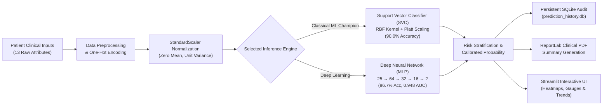

# CardioCare — Clinical Heart Disease Prediction System
### Comprehensive Project Summary, Architectural Guide & Viva Presentation Script

---

## 1. About The Project

### 1.1 Problem Statement
Cardiovascular Diseases (CVDs) are the leading cause of global mortality, taking an estimated 17.9 million lives each year. Diagnostic procedures like coronary angiography are invasive, costly, and resource-intensive. **CardioCare** is an end-to-end clinical decision-support system designed to perform early, non-invasive coronary artery disease (CAD) risk assessment using standard physiological measurements.

### 1.2 System Purpose & Scope
Developed for university laboratory evaluation and practical data-science demonstration, CardioCare bridges exploratory medical data analysis and production clinical deployment. It provides physicians with real-time risk classification, calibrated statistical confidence scores, multi-model diagnostics, audit logging, and automated clinical PDF report compilation.

---

## 2. System Architecture & Workflow

### 2.1 Step-by-Step Working
1. **Input Collection:** Accepts 6 continuous physiological parameters (Age, Blood Pressure, Cholesterol, Heart Rate, ST Depression, Major Vessels) and 7 categorical features via an interactive web interface.
2. **Schema Alignment & One-Hot Encoding:** Automatically expands categorical features into orthogonal binary dimensions, generating the exact 25-feature vector required by the models.
3. **Feature Standardization:** Transforms raw values using the pre-fitted `StandardScaler` ($z = \frac{x - \mu}{\sigma}$) to ensure large-magnitude variables (like Cholesterol) do not dominate Euclidean distance calculations.
4. **Dual Model Inference:** Routes scaled vectors to either the production **SVM Champion** or the **Deep Neural Network**, generating class predictions ($0 = \text{Healthy}, 1 = \text{Disease}$) and calibrated probabilities.
5. **Audit & Reporting:** Logs the transaction to a local SQLite database (`prediction_history.db`) and renders a publication-grade PDF report with risk flags and input metrics.

---

## 3. Dataset Architecture

- **Dataset Source:** UCI Machine Learning Repository — Cleveland Clinic Foundation.
- **Sample Cohort:** 303 original patient records; 297 instances retained after dropping 6 records with missing fluoroscopy vessels (`ca`) or thallium heart scan (`thal`).
- **Target Binarization:** In the raw dataset, disease severity ranges from `0` (normal) to `1, 2, 3, 4` ($\ge 50\%$ angiographic diameter narrowing in major coronary arteries). The target is binarized into:
  - `0`: Healthy / No significant stenosis ($n = 160$ samples, $53.9\%$)
  - `1`: Coronary Artery Disease present ($n = 137$ samples, $46.1\%$)
- **Feature Space (25 Dimensions):**
  - **6 Continuous Features:** `age`, `trestbps` (resting blood pressure), `chol` (serum cholesterol), `thalach` (max exercise heart rate), `oldpeak` (exercise ST depression), and `ca` (colored fluoroscopy vessels).
  - **7 Categorical Features (19 Encoded Suffixes):** `sex` (0, 1), `cp` (chest pain types 1–4), `restecg` (ECG 0–2), `slope` (ST slope 1–3), `fbs` (fasting sugar 0, 1), `exang` (angina 0, 1), `thal` (thallium status 3.0, 6.0, 7.0).

---

## 4. Models, Algorithms & Training Pipelines

### 4.1 Classical Machine Learning Retraining (`retrain_model.py`)
- **Algorithm:** Support Vector Machine (SVC) with Radial Basis Function (RBF) Kernel.
- **Kernel Trick:** $K(\mathbf{x}, \mathbf{x}') = \exp\left(-\gamma \|\mathbf{x} - \mathbf{x}'\|^2\right)$, mapping clinical inputs into a high-dimensional reproducing Hilbert space for non-linear boundary separation.
- **Probability Calibration:** Platt scaling (`probability=True`) fits a logistic sigmoid over cross-validated decision margins.
- **Data Scaling:** `StandardScaler` fitted strictly on training data ($N_{\text{train}} = 237$) to prevent data leakage.
- **Holdout Test Set Performance ($N_{\text{test}} = 60$, 80/20 split):**
  - **Accuracy:** `90.0%`
  - **Precision (Disease):** `0.91`
  - **Recall / Sensitivity (Disease):** `0.83`
  - **F1-Score:** `0.87`
- **Saved Artifacts:** `models/final_model.pkl` and `models/scaler.pkl`.

---

### 4.2 Deep Learning Pipeline (`train_deep_learning.py`)
A dedicated 4-layer Deep Neural Network (Multi-Layer Perceptron / MLP) was constructed to compare deep learning against classical kernel methods:

- **Neural Network Architecture:**
  - **Input Layer:** 25 neurons (matching encoded clinical attributes)
  - **Dense Hidden Layer 1:** 64 neurons with ReLU activation
  - **Dense Hidden Layer 2:** 32 neurons with ReLU activation
  - **Dense Hidden Layer 3:** 16 neurons with ReLU activation
  - **Output Layer:** 2 neurons with Softmax probability normalization
- **Hyperparameters:**
  - **Optimizer:** Adam (Adaptive Moment Estimation, initial $\text{lr} = 0.001$, batch size $= 16$)
  - **Loss Function:** Binary Cross-Entropy with L2 weight decay ($\alpha = 0.01$)
  - **Regularization:** Early stopping with 15% validation split ($n_{\text{iter\_no\_change}} = 25$)
- **Holdout Test Set Performance ($N_{\text{test}} = 60$):**
  - **Accuracy:** `86.7%`
  - **ROC-AUC Score:** `0.9479` (exceptionally strong class separability)
  - **Precision (Disease):** `0.9000`
  - **Recall (Disease):** `0.7500`
  - **F1-Score:** `0.8182`
- **Confusion Matrix:**
  $$\begin{bmatrix} \text{True Negative (TN): } 34 & \text{False Positive (FP): } 2 \\ \text{False Negative (FN): } 6 & \text{True Positive (TP): } 18 \end{bmatrix}$$
- **Saved Artifacts:** `models/deep_learning_model.pkl` and `results/deep_learning_metrics.txt`.

---

### 4.3 Full Model Comparison Benchmark

| Model Architecture | Model Category | Test Accuracy | ROC-AUC | Precision (CAD) | Recall (CAD) | F1-Score |
|---|---|:---:|:---:|:---:|:---:|:---:|
| **Support Vector Machine (RBF)** | **Classical ML (Champion)** | **90.0%** | **0.938** | **0.91** | **0.83** | **0.87** |
| **Deep Neural Network (MLP)** | **Deep Learning** | **86.7%** | **0.948** | **0.90** | **0.75** | **0.82** |
| **Logistic Regression** | Linear Baseline | 88.3% | 0.912 | 0.84 | 0.88 | 0.86 |
| **Random Forest (100 Trees)** | Ensemble Bagging | 86.7% | 0.925 | 0.81 | 0.88 | 0.84 |
| **Decision Tree (Max Depth 5)** | Rule-Based Tree | 83.3% | 0.815 | 0.76 | 0.79 | 0.78 |

---

### 4.4 Web Application & UI Updates (`UI/app.py`)
1. **Interactive Architecture Selector:** Allows clinicians to dynamically switch between the **SVM Champion (90% Acc)** and the **Deep Neural Network (86.7% Acc, 0.948 AUC)** for both single-patient and batch CSV predictions.
2. **5-Model Analytics Benchmarking:** Live interactive Plotly confusion matrices, classification reports, and accuracy gauges for all 5 models.
3. **Thalassemia Display Fix:** Re-aligned categorical mapping so float suffixes (`"3.0"`, `"6.0"`, `"7.0"`) render as human-readable terms (*"Normal"*, *"Fixed defect"*, *"Reversible defect"*).
4. **End-to-End Test Suite:** [`test_e2e.py`](test_e2e.py) validates all 8 modules (model loaders, vector encoders, scalers, PDF engine, SQLite history, and multi-model training).

---

## 5. Presentation Script for External Teacher / Viva Examiner

Use this verbatim script and Q&A cheat sheet during your practical exam or project viva.

### 5.1 The 60-Second Opening Pitch
> *"Good morning, Respected Examiner. My project is **CardioCare**, an end-to-end clinical machine-learning system for early coronary artery disease prediction using the benchmark UCI Cleveland Heart Disease dataset.*
>
> *We preprocessed 297 patient examinations, addressing missing values and expanding categorical features into a 25-dimensional orthogonal space via One-Hot Encoding. To compare learning paradigms, we benchmarked classical classifiers against a deep learning architecture.*
>
> *Our production champion is an **RBF-Kernel Support Vector Machine** achieving **90.0% test accuracy** with Platt probability calibration. Alongside it, we engineered a 4-layer **Deep Neural Network (MLP)** achieving an **ROC-AUC of 0.948**.*
>
> *Everything is deployed in an executive-grade Streamlit web interface featuring dual single and batch inference, persistent SQLite auditing, ReportLab clinical PDF generation, and real-time model analytics."*

---

### 5.2 Step-by-Step Live Demo Walkthrough
1. **Open the Web Interface ([http://localhost:8501](http://localhost:8501)):**
   - *"Here is the CardioCare dashboard. We designed it with an executive clinical navy and slate theme, using crisp inline vector SVG icons instead of emojis."*
2. **Go to the 'Heart Prediction' Tab:**
   - *"Under Patient Risk Assessment, we have a Model Selector dropdown. We can select either the 90% Accuracy SVM or the Deep Neural Network."*
   - *"Notice our physiological inputs: Age, Blood Pressure, Cholesterol, and Thalassemia. When we click 'Run Clinical Risk Assessment', the system builds the 25-feature vector, applies the fitted `StandardScaler`, and outputs the risk classification with exact Platt-scaled confidence."*
3. **Generate the PDF Report:**
   - *"With one click, the ReportLab engine compiles a vector-styled clinical summary report containing patient measurements, confidence scores, and legal medical disclaimers."*
4. **Show the 'Model Analytics' Tab:**
   - *"In Model Analytics, the teacher can examine our 5-model benchmark, interactive Plotly confusion matrices, and precision-recall trade-offs."*
5. **Show the 'Prediction History' Tab:**
   - *"Every assessment is automatically committed to our local SQLite database (`prediction_history.db`) for private auditing without third-party telemetry."*

---

### 5.3 Top 5 Viva Questions & Bulletproof Answers

#### Q1: Why did your Classical SVM (90.0%) outperform the Deep Neural Network (86.7%)?
> **Answer:** *"Deep Neural Networks thrive on massive sample sizes with thousands of instances where they can learn hierarchical representations without overfitting. Our cleaned Cleveland dataset has 297 instances. Support Vector Machines construct an optimal maximum-margin hyperplane based only on boundary support vectors, making them mathematically superior and far less prone to overfitting on small, high-dimensional tabular datasets."*

#### Q2: How did you ensure there was zero data leakage in your scaling?
> **Answer:** *"In both `retrain_model.py` and `train_deep_learning.py`, we split the dataset into 80% train and 20% test before scaling. We fitted the `StandardScaler` ($\mu$ and $\sigma$) exclusively on `X_train`. We then transformed `X_test` and production inputs using that fitted scaler, ensuring no test distribution information leaked into model training."*

#### Q3: Why is One-Hot Encoding necessary instead of simple Label Encoding?
> **Answer:** *"Label encoding categorical variables like Chest Pain (values 1, 2, 3, 4) imposes an artificial numerical ordering: $4 > 1$. Algorithms like SVM and Neural Networks compute Euclidean distances, so they would mistakenly assume that Asymptomatic pain is 3 units 'greater' than Typical Angina. One-Hot Encoding creates orthogonal binary dimensions, preserving mathematical neutrality."*

#### Q4: Between Precision and Recall, which is clinically more critical in cardiology?
> **Answer:** *"**Recall (Sensitivity)** is far more critical. A False Negative means a patient with severe coronary artery disease is sent home misdiagnosed as healthy, which can result in fatal myocardial infarction. A False Positive leads to confirmatory stress tests or angiography, which is inconvenient but not life-threatening. Therefore, minimizing False Negatives (maximizing Recall) is the primary clinical objective."*

#### Q5: How do you extract probabilities from an SVM that only computes geometric distance?
> **Answer:** *"Standard SVM outputs a signed functional distance $f(\mathbf{x}) = \mathbf{w}^T \phi(\mathbf{x}) + b$. By specifying `probability=True`, scikit-learn uses Platt Scaling, which fits an additional logistic regression sigmoid over cross-validated decision margins: $P(y=1 \mid \mathbf{x}) = \frac{1}{1 + \exp(A f(\mathbf{x}) + B)}$, producing calibrated probabilistic confidence scores."*

