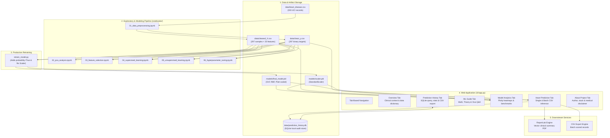
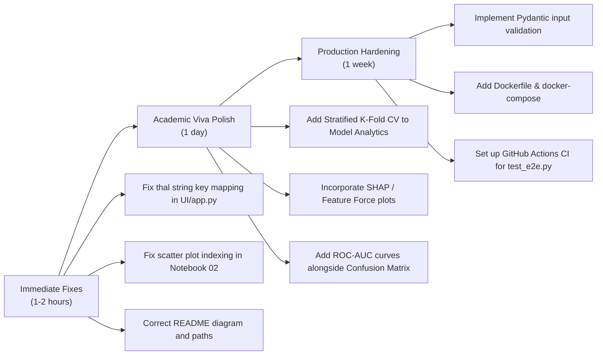

# CardioCare — Comprehensive Project Analysis & Technical Audit

> **Project Name:** CardioCare — Clinical Heart Disease Prediction System  
> **Repository:** [CardioCare](file:///d:/Professional/College/Github/CardioCare)  
> **Author:** Devang Deokule  
> **Target Domain:** Clinical Machine Learning & Healthcare Informatics  
> **Deployment Target:** [Streamlit Community Cloud](https://cardiocare-dslab.streamlit.app/) (Python 3.11)  
> **Champion Model:** Support Vector Machine (RBF Kernel, 90.0% Test Accuracy)

---

## 1. Executive Summary

**CardioCare** is an end-to-end, clinical-grade decision-support application designed to estimate coronary artery disease risk using the benchmark **UCI Cleveland Heart Disease dataset**. Built specifically for university data-science laboratory viva defense and portfolio demonstration, the system bridges the gap between academic Jupyter notebook experimentation and production web deployment.

The codebase encompasses the entire lifecycle of a classical machine-learning application:
1. **Exploratory Data Analysis & Preprocessing:** Data cleaning, missing-value imputation/removal, binarization, and One-Hot Encoding across 6 Jupyter notebooks.
2. **Model Research & Benchmarking:** Comparison of Logistic Regression, Decision Trees, Random Forests, and Support Vector Classifiers (SVC).
3. **Artifact Production:** Retraining pipeline (`retrain_model.py`) enabling Platt scaling (`probability=True`) and serialization of the fitted `StandardScaler` artifact.
4. **Interactive Clinical Interface (`UI/app.py`):** An extensive ~2,000-line Streamlit application featuring a clinical design language (SVG vector icons, custom CSS, zero emoji clutter), dual-mode inference (single patient & batch CSV), real-time model analytics, persistent SQLite auditing, and instant ReportLab PDF report generation.
5. **Quality Assurance:** An automated end-to-end verification script (`test_e2e.py`) validating all core subsystems.

---

## 2. System Architecture & Component Topology



---

## 3. Directory Structure & File Inventory

| Path | File Size | Description |
|---|---|---|
| [`.streamlit/config.toml`](file:///d:/Professional/College/Github/CardioCare/.streamlit/config.toml) | 264 B | Streamlit theme configuration (custom clinical palette: primary `#2563EB`, background `#F8FAFC`). |
| [`.python-version`](file:///d:/Professional/College/Github/CardioCare/.python-version) | 6 B | Python runtime specification (`3.11`) ensuring deterministic builds on Streamlit Cloud. |
| [`requirements.txt`](file:///d:/Professional/College/Github/CardioCare/requirements.txt) | 220 B | Pinned dependencies (`numpy`, `pandas`, `scikit-learn`, `joblib`, `streamlit`, `plotly`, `reportlab`). |
| [`retrain_model.py`](file:///d:/Professional/College/Github/CardioCare/retrain_model.py) | 2.5 KB | Production retraining script fitting `StandardScaler` and `SVC(probability=True)`. |
| [`test_e2e.py`](file:///d:/Professional/College/Github/CardioCare/test_e2e.py) | 5.4 KB | Comprehensive 8-stage integration test suite. |
| [`data/heart_disease.csv`](file:///d:/Professional/College/Github/CardioCare/data/heart_disease.csv) | 12.8 KB | Raw UCI Cleveland dataset (303 records, 14 attributes). |
| [`data/cleaned_X.csv`](file:///d:/Professional/College/Github/CardioCare/data/cleaned_X.csv) | 39.1 KB | Preprocessed feature matrix (297 samples, 25 one-hot encoded columns). |
| [`data/clean_y.csv`](file:///d:/Professional/College/Github/CardioCare/data/clean_y.csv) | 899 B | Preprocessed binary labels (0 = Healthy [160], 1 = Disease [137]). |
| [`data/prediction_history.db`](file:///d:/Professional/College/Github/CardioCare/data/prediction_history.db) | 12.3 KB | SQLite database storing local user predictions with schema auto-migration. |
| [`models/final_model.pkl`](file:///d:/Professional/College/Github/CardioCare/models/final_model.pkl) | 33.4 KB | Serialized Support Vector Classifier with Platt probability scaling. |
| [`models/scaler.pkl`](file:///d:/Professional/College/Github/CardioCare/models/scaler.pkl) | 1.6 KB | Serialized `StandardScaler` fitted on the 237 training cases. |
| [`models/final_model_original_backup.pkl`](file:///d:/Professional/College/Github/CardioCare/models/final_model_original_backup.pkl) | 33.4 KB | Safety backup of the legacy SVM artifact prior to Platt calibration. |
| [`notebooks/01_data_preprocessing.ipynb`](file:///d:/Professional/College/Github/CardioCare/notebooks/01_data_preprocessing.ipynb) | 485 KB | Missing value resolution, binarization, one-hot encoding, and correlation heatmaps. |
| [`notebooks/02_pca_analysis.ipynb`](file:///d:/Professional/College/Github/CardioCare/notebooks/02_pca_analysis.ipynb) | 152 KB | Dimensionality reduction via Principal Component Analysis (95% variance). |
| [`notebooks/03_feature_selection.ipynb`](file:///d:/Professional/College/Github/CardioCare/notebooks/03_feature_selection.ipynb) | 190 KB | Feature importance scoring (Random Forest, Gradient Boosting, Chi-Square). |
| [`notebooks/04_supervised_learning.ipynb`](file:///d:/Professional/College/Github/CardioCare/notebooks/04_supervised_learning.ipynb) | 240 KB | Benchmarking 4 classifiers (LR, DT, RF, SVM) and initial SVM model export. |
| [`notebooks/05_unsupervised_learning.ipynb`](file:///d:/Professional/College/Github/CardioCare/notebooks/05_unsupervised_learning.ipynb) | 211 KB | K-Means clustering (Elbow curve, optimal $K=4$) and Hierarchical Dendrogram. |
| [`notebooks/06_hyperparameter_tuning.ipynb`](file:///d:/Professional/College/Github/CardioCare/notebooks/06_hyperparameter_tuning.ipynb) | 3.7 KB | `GridSearchCV` hyperparameter tuning for Logistic Regression. |
| [`results/evaluation_metrics.txt`](file:///d:/Professional/College/Github/CardioCare/results/evaluation_metrics.txt) | 938 B | Benchmark classification reports and confusion matrices for viva evaluation. |
| [`UI/app.py`](file:///d:/Professional/College/Github/CardioCare/UI/app.py) | 89.6 KB | Main Streamlit interface (1,996 lines), UI styling, inference engine, PDF generator. |

---

## 4. Machine Learning & Data Pipeline Deep Dive

### 4.1. Dataset Characteristics & Preprocessing
- **Source Cohort:** UCI Machine Learning Repository — Cleveland Clinic Foundation database.
- **Sample Truncation:** 303 raw samples reduced to 297 instances by dropping 6 patient records containing missing values (`?` / `NaN` in fluoroscopy vessels `ca` and thallium scan `thal`).
- **Target Binarization:** In the raw dataset, `target` ranges from `0` (absence of CAD) to `1, 2, 3, 4` (angiographically confirmed narrowing $\ge 50\%$). The pipeline binarizes this into:
  $$\text{target} = \begin{cases} 0 & \text{if } y = 0 \text{ (Normal/Healthy, } n=160\text{)} \\ 1 & \text{if } y \ge 1 \text{ (Coronary Disease, } n=137\text{)} \end{cases}$$
- **Feature Space Expansion (25 Dimensions):**
  Continuous features ($n=6$) are preserved: `age`, `trestbps` (resting blood pressure), `chol` (serum cholesterol), `thalach` (max heart rate), `oldpeak` (ST depression), and `ca` (colored vessels).  
  Categorical variables ($n=7$) are transformed via One-Hot Encoding (`sex`, `cp`, `restecg`, `slope`, `fbs`, `exang`, `thal`), producing 19 orthogonal binary columns for a total of 25 input features.

### 4.2. Feature Scaling Hygiene & Inference Consistency
Support Vector Machines rely on Euclidean distance calculations:
$$d(\mathbf{x}_i, \mathbf{x}_j) = \sqrt{\sum_{k=1}^{25} (x_{ik} - x_{jk})^2}$$
Without normalization, attributes with wide clinical ranges (e.g., Cholesterol: 126–564 mg/dl) would dominate the kernel distance over subtle attributes like ST depression (0.0–6.2 mm).

- **Training Discipline:** In [`retrain_model.py`](file:///d:/Professional/College/Github/CardioCare/retrain_model.py#L44-L48), the `StandardScaler` is fitted **exclusively on the training fold (`X_train`)** to eliminate data leakage:
  $$\mu = \frac{1}{N_{\text{train}}}\sum_{i} x_i, \quad \sigma = \sqrt{\frac{1}{N_{\text{train}}}\sum_{i}(x_i - \mu)^2}$$
- **Inference Guarantee:** The fitted `scaler.pkl` artifact is persisted alongside `final_model.pkl` and loaded dynamically during inference in [`UI/app.py`](file:///d:/Professional/College/Github/CardioCare/UI/app.py#L1242-L1246), guaranteeing zero distribution shift between training and runtime.

### 4.3. Model Benchmark & Champion Selection
On the held-out test set ($N=60$ samples; 80/20 train/test split with `random_state=42`):

| Model | Test Accuracy | Precision (CAD) | Recall / Sensitivity (CAD) | F1-Score (CAD) | Support (Healthy / CAD) |
|---|:---:|:---:|:---:|:---:|:---:|
| **Decision Tree** | 81.7% | 0.76 | 0.79 | 0.78 | 36 / 24 |
| **Random Forest** | 87.0% | 0.81 | 0.88 | 0.84 | 36 / 24 |
| **Logistic Regression** | 88.3% | 0.84 | 0.88 | 0.86 | 36 / 24 |
| **Support Vector Machine (RBF)** | **90.0%** | **0.91** | **0.83** | **0.87** | **36 / 24** |

**Why SVM Won:**
The Radial Basis Function (RBF) kernel:
$$K(\mathbf{x}, \mathbf{x}') = \exp\left(-\gamma \|\mathbf{x} - \mathbf{x}'\|^2\right)$$
efficiently maps patient attributes into an implicit reproducing kernel Hilbert space (RKHS), yielding a maximum-margin hyperplane that separates healthy from diseased profiles with fewer misclassifications than linear or unpruned tree baselines.

### 4.4. Platt Scaling for Clinical Confidence
Standard SVMs output an uncalibrated signed geometric distance $f(\mathbf{x}) = \mathbf{w}^T \phi(\mathbf{x}) + b$.  
In [`retrain_model.py`](file:///d:/Professional/College/Github/CardioCare/retrain_model.py#L50), `SVC(kernel="rbf", random_state=42, probability=True)` was applied. This fits a post-hoc logistic sigmoid over 5-fold cross-validated decision values:
$$P(y=1 \mid \mathbf{x}) = \frac{1}{1 + \exp(A \cdot f(\mathbf{x}) + B)}$$
allowing the web interface to display nuanced probability confidence percentages rather than a raw binary output.

---

## 5. Frontend & Software Architecture (`UI/app.py`)

The user interface is an example of disciplined Streamlit development:

1. **Executive Clinical Styling:**
   - Instead of default Streamlit emojis, the interface uses 15+ custom inline SVG vector icons (`heart`, `pulse`, `brain`, `stethoscope`, `shield`, `analytics`).
   - Custom CSS injected via `inject_css()` enforces an enterprise medical design palette (Deep Navy `#1E3A8A`, Clinical Blue `#2563EB`, Slate `#64748B`, Alert Red `#DC2626`, Success Emerald `#059669`).
   - Uses high-contrast card structures (`.cc-card`, `.cc-result-card`, `.cc-metric-card`).

2. **Performance Caching Strategy:**
   - Model weights and scalers are loaded once using `@st.cache_resource`.
   - Cleaned datasets and evaluation benchmarks use `@st.cache_data`, ensuring rapid tab switching without re-fitting models on every interaction.

3. **Dual Inference Modes:**
   - **Single Patient Form:** Provides numeric inputs with physiologically bounded ranges (`min_value`, `max_value`, `default`) and categorical select boxes. Automatically reconstructs the exact 25-feature vector required by the model.
   - **Batch Processing:** Allows users to download a schema template CSV, upload batch datasets, validates the presence of all 25 columns, executes scaled batch predictions, and offers an instant CSV download with risk labels and probabilities.

4. **Persistence & Auditing (SQLite):**
   - Stores each patient assessment in `data/prediction_history.db`.
   - Features dynamic schema migration (`ALTER TABLE`) if older databases exist on disk.
   - Provides an audit trail tab with KPI summary metrics, recent prediction tables, and a database wipe option.

5. **ReportLab PDF Generation:**
   - Uses ReportLab flowables (`SimpleDocTemplate`, `Paragraph`, `Table`, `HRFlowable`) to dynamically compile a publication-grade A4/Letter clinical report.
   - Embeds risk assessments, calculated probabilities, patient measurements, model metadata, and a standard legal medical disclaimer.

6. **Academic Viva & ML Guide Tab:**
   - Formulates the mathematical foundation of Supervised Classification ($f: \mathcal{X} \rightarrow \mathcal{Y}$).
   - Clarifies why One-Hot Encoding is mathematically mandatory (prevents artificial Euclidean distance distortion where `Asymptomatic (4) > Typical Angina (1)`).
   - Clarifies why feature standardization is required for distance-based kernels.
   - Includes a **Top 10 Viva Q&A cheat sheet** tailored for university examination defense.

---

## 6. Codebase Audits & Discovered Nuances

During our detailed code inspection, several subtle bugs, historical artifacts, and technical improvements were identified:

### ⚠️ Bug 1: Thalassemia Frontend Dropdown Key Mismatch
- **Location:** [`UI/app.py`](file:///d:/Professional/College/Github/CardioCare/UI/app.py#L151-L160) vs [`cleaned_X.csv`](file:///d:/Professional/College/Github/CardioCare/data/cleaned_X.csv#L1)
- **Detail:** In `CATEGORICAL_FEATURES["thal"]["options"]`, the keys are defined as integer strings:
  ```python
  "thal": {
      "label": "Thalassemia",
      "options": {"3": "Normal", "6": "Fixed defect", "7": "Reversible defect"},
  }
  ```
  However, in `data/cleaned_X.csv`, because the original dataset had missing values, pandas imported `thal` as a float, resulting in column headers `thal_3.0`, `thal_6.0`, `thal_7.0`.  
  In `_select_cat()`, `avail_keys` extracts `['3.0', '6.0', '7.0']`. Because `'3.0'` is not found in `options`, `display_map` defaults to `{ '3.0': '3.0', '6.0': '6.0', '7.0': '7.0' }`.
- **Symptom:** On the web interface, the Thalassemia dropdown shows raw numeric strings (`"3.0"`, `"6.0"`, `"7.0"`) instead of `"Normal"`, `"Fixed defect"`, and `"Reversible defect"`. In the generated PDF report, it prints `"3.0"` instead of `"Normal"`.
- **Fix:** Update `CATEGORICAL_FEATURES["thal"]["options"]` to accept both float and integer string keys:
  ```python
  "options": {
      "3": "Normal", "3.0": "Normal",
      "6": "Fixed defect", "6.0": "Fixed defect",
      "7": "Reversible defect", "7.0": "Reversible defect",
  }
  ```

---

### ⚠️ Bug 2: Scatter Plot Bug in Notebook 02
- **Location:** [`notebooks/02_pca_analysis.ipynb`](file:///d:/Professional/College/Github/CardioCare/notebooks/02_pca_analysis.ipynb#L3) (Cell 3)
- **Detail:** After fitting PCA (`pca = PCA(n_components=0.95); X_pca = pca.fit_transform(X)`), the visualization code calls:
  ```python
  plt.scatter(X[:, 0], X[:, 1], c=y['target'], cmap='viridis')
  plt.xlabel('First Pricipal Component')
  plt.ylabel('Second Principal Component')
  ```
- **Symptom:** The plot actually renders the first two normalized input features (`age` vs `trestbps`) rather than the first two principal components (`X_pca[:, 0]` vs `X_pca[:, 1]`).

---

### ⚠️ Bug 3: Copy-Paste Print Statements in Notebook 03
- **Location:** [`notebooks/03_feature_selection.ipynb`](file:///d:/Professional/College/Github/CardioCare/notebooks/03_feature_selection.ipynb) (Cells 7 & 10)
- **Detail:**
  - Cell 7: `print(f'Top 5 Features for Gradient Boosting Model: \n{importance_rf[:5]} ')` prints the Random Forest table rather than `importance_gb[:5]`.
  - Cell 10: `print(f'Top 5 Features for Random Forest Model: {feature_scores_df[:5]} ')` labels Chi-Square results as "Random Forest Model".

---

### ⚠️ Bug 4: README Directory Header Typo
- **Location:** [`README.md`](file:///d:/Professional/College/Github/CardioCare/README.md#L28) and line 69
- **Detail:** In line 28 of `README.md`, the root project folder is named `Diabetes-Predictor/` instead of `CardioCare/`, and line 69 contains a developer-specific local OneDrive path (`c:\Users\Devang\OneDrive\Desktop\DSL\CardioCare`).

---

### ⚠️ Bug 5: Holdout Evaluation vs Cross-Validation
- **Location:** [`retrain_model.py`](file:///d:/Professional/College/Github/CardioCare/retrain_model.py#L38) & [`notebooks/04_supervised_learning.ipynb`](file:///d:/Professional/College/Github/CardioCare/notebooks/04_supervised_learning.ipynb#L3)
- **Detail:** The 90.0% test accuracy was measured on a single 80/20 train/test split ($N_{\text{test}} = 60$). With 60 samples, a single correct/incorrect prediction shifts the accuracy by $\pm 1.67\%$. While appropriate for academic lab demonstration matching the original assignment, a $K$-fold stratified cross-validation ($K=5$ or $10$) would provide a more robust confidence interval for clinical reporting.

---

## 7. Actionable Recommendations & Roadmap



### Priority 1: Immediate Polish (Ready to apply)
1. **Fix Thalassemia Key Matching:** Update `CATEGORICAL_FEATURES["thal"]["options"]` in [`UI/app.py`](file:///d:/Professional/College/Github/CardioCare/UI/app.py#L153) to support `"3.0"`, `"6.0"`, `"7.0"` so human-readable labels appear everywhere.
2. **Clean Notebook Display Bugs:** Update `X_pca` indexing in `02_pca_analysis.ipynb` and feature importance prints in `03_feature_selection.ipynb`.
3. **Correct README.md Structure:** Fix `Diabetes-Predictor/` to `CardioCare/` and generalize the clone instructions.

### Priority 2: Academic & Laboratory Viva Enhancements
1. **Add ROC-AUC Curves:** Add ROC-AUC curves in `render_analytics()` to show discrimination capability across varying decision thresholds.
2. **Model Explainability (SHAP/TreeSHAP):** Integrating a waterfall SHAP plot in the single-patient view would allow an examiner or physician to see exactly which factor (e.g., $+18\%$ risk from ST depression, $-12\%$ from high maximum heart rate) drove an individual prediction.
3. **K-Fold Cross-Validation Metrics:** Display $5$-fold stratified cross-validation mean accuracy $\pm$ standard deviation to demonstrate model stability against test set selection bias.

### Priority 3: Production & Software Engineering
1. **Continuous Integration (CI):** Add `.github/workflows/ci.yml` running `python test_e2e.py` on pull requests to ensure code stability.
2. **Containerization:** Add a minimal `Dockerfile` based on `python:3.11-slim` for self-contained, reproducible deployment across any operating system.
3. **Input Schema Validation:** Wrap user inputs with Pydantic or a typed dictionary to enforce strict type checking and range enforcement before reaching the scaler.

---

## 8. Conclusion

**CardioCare** is a well-engineered, aesthetically sophisticated, and academically thorough machine-learning project. Its strengths lie in its adherence to proper preprocessing practices (strictly avoiding data leakage during scaling), comprehensive viva documentation within the web application itself, and a clean clinical UI. Addressing the small UI key mismatch and notebook visualization artifacts identified in this report will bring the codebase to an exemplary standard.
